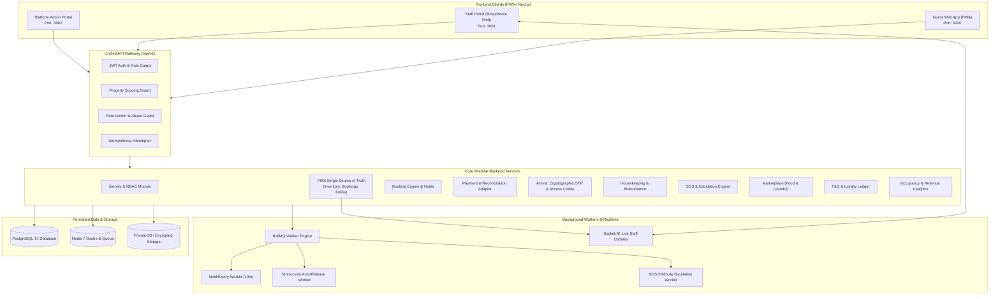

# HOTELYO - System Architecture Specification

## 1. Architectural Style: Modular Monolith
HOTELYO is architected as a production-grade **Modular Monolith** behind a single versioned REST API (`/api/v1`), serving the Guest Web Application, Staff Portal, Admin Dashboard, and future client applications.



## 2. Monorepo Organization
The codebase is structured as a clear monorepo using pnpm workspaces:

```text
HOTELYO/
├── apps/
│   ├── api/             # NestJS Modular Monolith REST API (/api/v1)
│   ├── guest-web/       # Next.js 14 App Router Guest PWA
│   ├── staff-web/       # Next.js 14 App Router Staff Operations Portal
│   ├── admin-web/       # Next.js 14 App Router Admin & Analytics Portal
│   └── worker/          # BullMQ Background Job Processors
├── packages/
│   ├── shared-types/    # TypeScript DTOs, Enums, API Interfaces
│   ├── validation/      # Zod validation schemas shared across FE & BE
│   ├── ui/              # Reusable Tailwind / shadcn/ui components
│   └── config/          # Shared ESLint, Prettier, TypeScript configurations
├── prisma/
│   ├── schema.prisma    # Authoritative normalized PostgreSQL schema
│   ├── migrations/      # Version-controlled SQL migrations
│   └── seed.ts          # Deterministic, safe synthetic seed data
├── docs/                # Architecture, API guides, ADRs, and runbooks
├── docker-compose.yml   # Multi-service local and staging orchestration
└── .env.example         # Documented environment configuration
```

## 3. Technology Stack Justification
- **Backend (NestJS + TypeScript):** Enterprise-grade modular architecture with strict dependency injection, built-in validation pipes, OpenAPI documentation generation, and guards for property scoping and RBAC.
- **Frontend (Next.js App Router + React + Tailwind + TanStack Query):** High-performance server/client component model, responsive mobile-first UI for hostel travelers, and PWA service-worker offline caching.
- **Database (PostgreSQL 17 + Prisma ORM):** ACID transactional guarantees, composite unique indexes for strict anti-double-booking invariant enforcement, and point-in-time recovery capabilities.
- **Queue & Realtime (BullMQ + Redis + Socket.IO):** High-throughput, distributed job scheduling for hold expirations, auto-release jobs, and sub-5-second SOS alert propagation.
