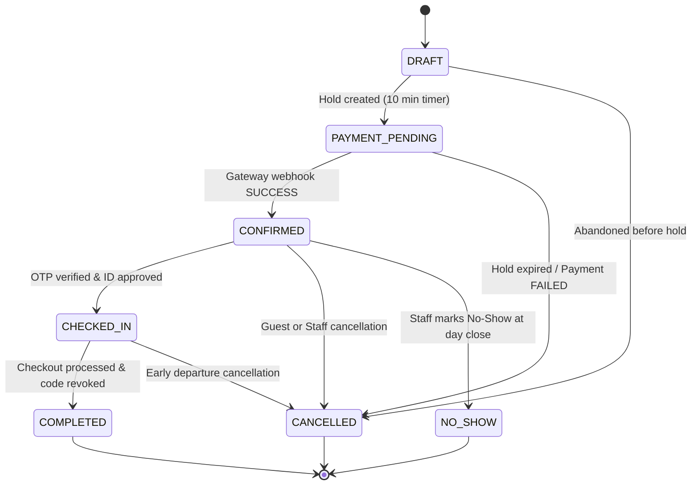

# HOTELYO - Booking State Machine Specification

## 1. States & Definitions
- `DRAFT`: Initial cart/checkout session created; inventory hold not yet confirmed.
- `PAYMENT_PENDING`: Bed-nights held in `BedNightAllocation` (10-minute expiry); awaiting payment gateway callback.
- `CONFIRMED`: Payment verified or authorized front-desk booking; beds firmly locked.
- `CHECKED_IN`: Guest has completed arrival OTP verification and pre-check-in ID approval; access code active.
- `COMPLETED`: Guest has checked out; access code revoked; folio settled.
- `CANCELLED`: Booking cancelled prior to or on arrival date; refund processed if eligible per policy; inventory released.
- `NO_SHOW`: Guest failed to arrive on the scheduled check-in date; cancellation policy applied; inventory released.

## 2. Transition Diagram

## 3. Invariants & Transition Rules
1. **Separation of Concerns:** Payment failure transitions booking to `CANCELLED` (or returns to `DRAFT` if user retries within hold window). Never mark `CONFIRMED` until signed payment webhook is validated.
2. **Hold Expiry:** If the 10-minute hold window lapses without payment completion, the background worker releases the `BedNightAllocation` rows and transitions booking to `CANCELLED`.
3. **Inventory Release on Cancellation:** Whenever a booking transitions to `CANCELLED` or `NO_SHOW`, its `BedNightAllocation` rows must be transitioned to `RELEASED` or deleted within the same database transaction.
4. **Access Code Revocation:** Whenever a booking transitions to `COMPLETED` or `CANCELLED`, any active room access codes must be revoked within 60 seconds.
