# HOTELYO - PostgreSQL Database Schema Specification

## 1. Schema Design Principles
1. **Normalization & Referential Integrity:** Fully normalized relational schema with explicit foreign keys, cascading or restrict delete behaviors, and composite unique keys.
2. **Double-Booking Prevention:** Hard database-level invariant on `BedNightAllocation` with `UNIQUE(bed_id, calendar_date)`.
3. **Monetary Values:** Stored as integer minor units (`amount_in_paise` as BigInt/Integer) with ISO currency code `INR`.
4. **Time & Dates:** Timestamps stored in UTC (`TIMESTAMPTZ`). Local business dates stored as `DATE` (`calendar_date`) to guarantee time-zone-independent accounting.
5. **Auditing & Immutability:** Sensitive entities (TaxInvoices, CreditNotes, DailyClose, AuditLog, LoyaltyLedgerEntry) are append-only.

## 2. Entity-Relationship Overview

```mermaid
erDiagram
    PROPERTY ||--o{ ROOM : contains
    ROOM ||--o{ BED : contains
    BED ||--o{ BED_NIGHT_ALLOCATION : allocated_for
    PROPERTY ||--o{ PARKING_SPACE : provides
    PROPERTY ||--o{ GEAR_LOCKER : provides
    PROPERTY ||--o{ RATE_PLAN : defines
    
    USER ||--o{ BOOKING : creates
    BOOKING ||--o{ BOOKING_ITEM : includes
    BOOKING_ITEM ||--o{ BED_NIGHT_ALLOCATION : reserves
    BOOKING ||--o{ BOOKING_HOLD : holds
    BOOKING ||--o{ GUEST_FOLIO : accumulates
    GUEST_FOLIO ||--o{ FOLIO_LINE_ITEM : contains
    GUEST_FOLIO ||--o{ TAX_INVOICE : billed_as
    
    BOOKING ||--o{ PAYMENT : settles
    PAYMENT ||--o{ REFUND : adjusted_by
    
    BOOKING ||--o{ IDENTITY_DOCUMENT : verifies
    BOOKING ||--o{ ARRIVAL_OTP_CHALLENGE : authenticates
    BOOKING ||--o{ ACCESS_CODE : unlocks
    
    PROPERTY ||--o{ HOUSEKEEPING_TASK : manages
    PROPERTY ||--o{ MAINTENANCE_TICKET : tracks
    PROPERTY ||--o{ SOS_ALERT : protects
    SOS_ALERT ||--o{ SOS_ESCALATION : escalates
    
    PROPERTY ||--o{ MENU_ITEM : serves
    BOOKING ||--o{ FOOD_ORDER : orders
    BOOKING ||--o{ LAUNDRY_ORDER : requests
    
    USER ||--o{ LOYALTY_ACCOUNT : owns
    LOYALTY_ACCOUNT ||--o{ LOYALTY_LEDGER_ENTRY : transacts
```

## 3. Core Tables Summary (Normalized PostgreSQL Architecture)
The schema groups 45 core and supporting tables across 9 distinct domain domains:
1. **Tenancy & IAM:** `User`, `UserCredential`, `Role`, `UserRoleAssignment`, `PropertyMembership`, `Session`, `GuestProfile`, `StaffProfile`, `VendorProfile`
2. **Property & Inventory:** `Property`, `PropertySetting`, `Room`, `Bed`, `BedSegment`, `InventoryBlock`, `BedNightAllocation`, `RatePlan`, `NightlyRate`, `ParkingSpace`, `GearLocker`, `BookableResourceReservation`
3. **Reservations & Coupons:** `Booking`, `BookingItem`, `BookingGuest`, `BookingHold`, `BookingStateHistory`, `BookingCancellation`, `Coupon`, `CouponRedemption`, `GroupBooking`, `GroupBookingMember`, `SavedPaymentMethodReference`
4. **Payments, Invoicing & Folios:** `Payment`, `PaymentAttempt`, `PaymentWebhookEvent`, `Refund`, `GuestFolio`, `FolioLineItem`, `TaxInvoice`, `CreditNote`, `DailyClose`, `ReconciliationRecord`
5. **Arrival & Access:** `IdentityDocument`, `IdentityVerification`, `ArrivalOTPChallenge`, `AccessCode`, `VisitorAccessPass`, `ExtendedStayAccessRecord`, `AccessRevocationRecord`
6. **Operations:** `HousekeepingTask`, `MaintenanceTicket`, `GuestServiceRequest`, `TaskAssignment`, `StaffShift`
7. **Safety:** `SOSAlert`, `SOSAcknowledgement`, `SOSEscalation`, `EmergencyContact`, `IncidentReport`
8. **Marketplace & Notifications:** `Notification`, `NotificationTemplate`, `PushSubscription`, `VendorService`, `MenuCategory`, `MenuItem`, `FoodOrder`, `FoodOrderItem`, `LaundryService`, `LaundryOrder`
9. **Engagement & System:** `Feedback`, `Review`, `FAQCategory`, `FAQArticle`, `LoyaltyAccount`, `LoyaltyLedgerEntry`, `AuditLog`, `FeatureFlag`, `IdempotencyRecord`
