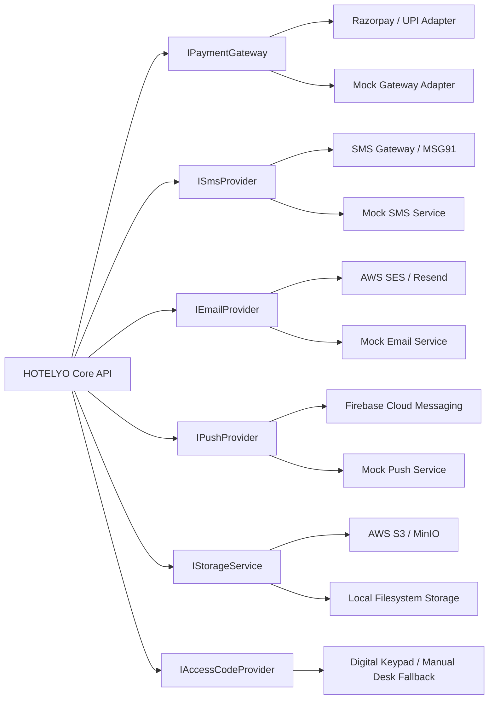

# HOTELYO - Third-Party Integrations Specification

## 1. Integration Landscape & Provider Adapters
All external service integrations are decoupled behind clean provider interfaces with local mock implementations for deterministic testing and CI.

## 2. Integration Details

### A. Payment Gateway (Razorpay / UPI)
- **Adapter Interface:** `IPaymentGateway`
  - `createOrder(bookingId: string, amountPaise: number, currency: string)`
  - `verifyWebhookSignature(payload: string, signature: string): boolean`
  - `initiateRefund(paymentId: string, amountPaise: number, reason: string)`
- **Webhook Handling:** Verifies HMAC-SHA256 signature using `RAZORPAY_WEBHOOK_SECRET`. Handles `payment.captured`, `payment.failed`, `refund.processed`.

### B. SMS & OTP Dispatch
- **Adapter Interface:** `ISmsProvider`
  - `sendOtp(phone: string, otp: string): Promise<boolean>`
  - `sendBookingConfirmation(phone: string, ref: string, dates: string)`
  - `sendSosAlert(phone: string, alertDetails: object)`
- **Registered DLT Templates (India):** Configured for Indian Telecom DLT (Distributed Ledger Technology) template IDs.

### C. Web Push (Firebase Cloud Messaging - Option B)
- **Adapter Interface:** `IPushProvider`
  - `sendPushNotification(token: string, title: string, body: string, data?: object)`
  - Subscriptions persisted in `PushSubscription` table.

### D. Private Object Storage (S3 / MinIO)
- **Adapter Interface:** `IStorageService`
  - `getUploadSignedUrl(key: string, contentType: string, expiresSeconds: number)`
  - `getDownloadSignedUrl(key: string, expiresSeconds: number)`
