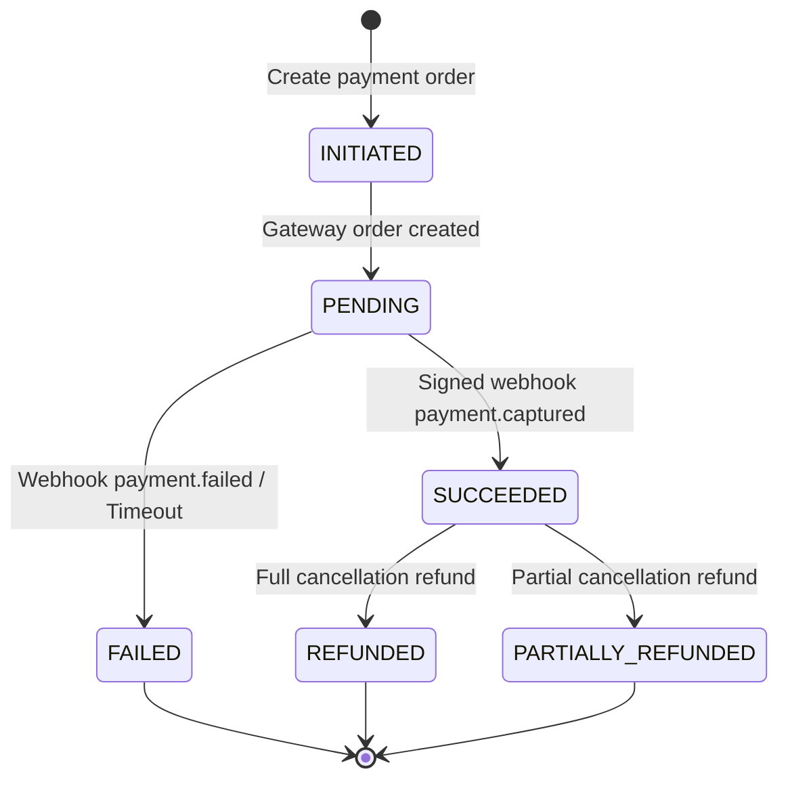

# HOTELYO - Payment State Machine Specification

## 1. States & Definitions
- `INITIATED`: Payment order created on the server and registered with the gateway (Razorpay/UPI).
- `PENDING`: Guest redirected to gateway / UPI intent triggered; awaiting gateway event.
- `SUCCEEDED`: Signed webhook received and verified; payment captured; booking marked `CONFIRMED`.
- `FAILED`: Gateway notified failure, user cancelled, or transaction timed out.
- `REFUNDED`: Full amount returned to guest via gateway API; credit note generated.
- `PARTIALLY_REFUNDED`: Partial cancellation or authorized adjustment refunded; credit note generated.

## 2. Transition Diagram

## 3. Financial Integrity Invariants
1. **Integer Minor Units:** All payment fields (`amountPaise`, `refundedAmountPaise`) are stored as 64-bit integers.
2. **Webhook Replay Protection:** Every webhook delivery contains a unique `event_id` checked against `PaymentWebhookEvent`. If `event_id` already exists, return HTTP 200 OK without re-processing.
3. **Refund Authorization:** A refund can never exceed `(amountPaise - refundedAmountPaise)`.
4. **Folio Credit/Debit Symmetry:** Every payment credit generates an immutable line item in `GuestFolio`.
