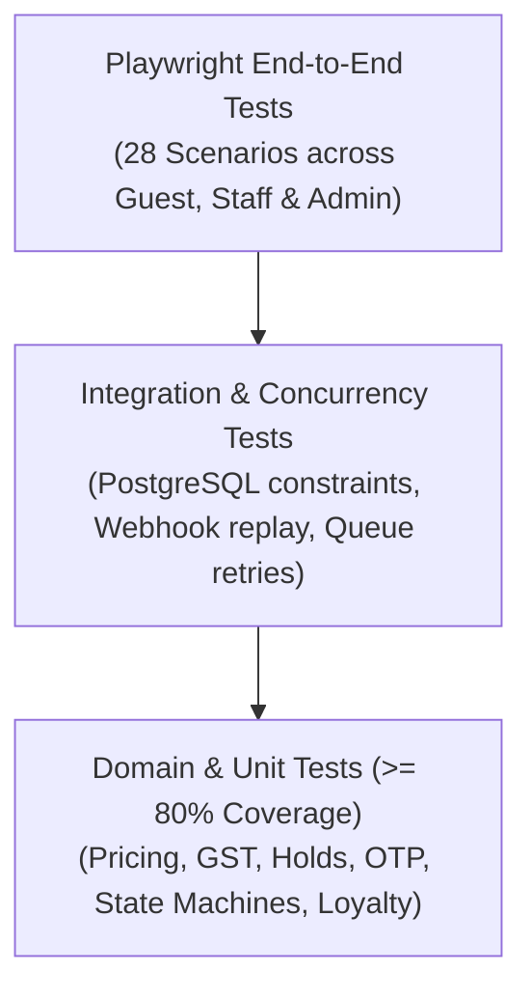

# HOTELYO - Test Automation and Quality Assurance Strategy

## 1. Testing Pyramid & Quality Targets
- **Target Coverage:** Business logic unit test coverage >= 80%.
- **Gate Criteria:** No critical or high severity defects; 100% of adversarial security and concurrency test cases passing in CI.

## 2. Test Suites Overview

### A. Unit Tests
- `pricing.service.spec.ts`: GST slabs, motorcycle add-ons, integer minor unit arithmetic, zero/negative price prevention.
- `coupon.service.spec.ts`: Minimum spend, usage limits, non-stackable coupon rules.
- `booking-state-machine.spec.ts`: Valid/invalid state transitions, illegal rollback rejections.
- `otp.service.spec.ts`: Keyed HMAC hashing, 15m expiration, 5-attempt lockout, 30s resend cooldown.
- `access-code.service.spec.ts`: Code issuance, validity period, revocation on checkout.
- `loyalty.service.spec.ts`: Point accrual calculation, redemption ledger, zero negative balance invariant.

### B. Integration Tests
- `double-booking-concurrency.spec.ts`: Concurrent Promise.all() holds on the identical bed-night testing PostgreSQL unique constraint `idx_bed_night_active`.
- `payment-webhook-replay.spec.ts`: Submitting identical webhook payloads twice to verify idempotent processing without duplicate confirmed bookings or folios.
- `property-isolation.spec.ts`: Property A staff member attempting to query Property B bookings or folios (expecting HTTP 403 Forbidden).
- `vendor-isolation.spec.ts`: Vendor attempting to retrieve orders belonging to another vendor (expecting HTTP 403 Forbidden).

### C. Playwright End-to-End (E2E) Test Suite (28 Scenarios)
1. Guest registration and authentication.
2. Property search and bed availability exploration.
3. Five-screen checkout flow.
4. Gateway payment initiation and success webhook.
5. Failed payment transaction and cart recovery.
6. Duplicate payment webhook handling.
7. Booking confirmation and receipt generation.
8. Pre-arrival identity document upload to private S3.
9. Staff dashboard document verification.
10. Guest arrival 6-digit cryptographic OTP generation.
11. Front-desk OTP verification and check-in.
12. Room access-code display and immediate revocation upon checkout.
13. Front-desk walk-in reservation creation.
14. Checkout and automated GST tax invoice / folio generation.
15. Booking cancellation with server-side refund computation.
16. Coupon validation and discount application.
17. Multi-bed group booking creation.
18. Motorcycle unsold inventory auto-release verification.
19. Housekeeping task assignment and completion.
20. Maintenance ticket creation and bed inventory blocking.
21. 1-click SOS alert trigger and 2-minute escalation drill.
22. Marketplace food ordering and vendor inbox status update.
23. Laundry service ordering and pickup workflow.
24. FAQ category creation and guest-facing search.
25. Loyalty points accrual and checkout redemption.
26. Web push notification subscription registration.
27. Property analytics calculation verification (Occupancy, RevPAB).
28. Offline PWA shell and cached last-booking summary.

## 3. Adversarial Edge Case Verification
- Hold expiry racing with checkout submission.
- Payment callback arriving for an already cancelled hold.
- Staff user attempting unauthorized cross-property inspection.
- Re-use of verified arrival OTP.
